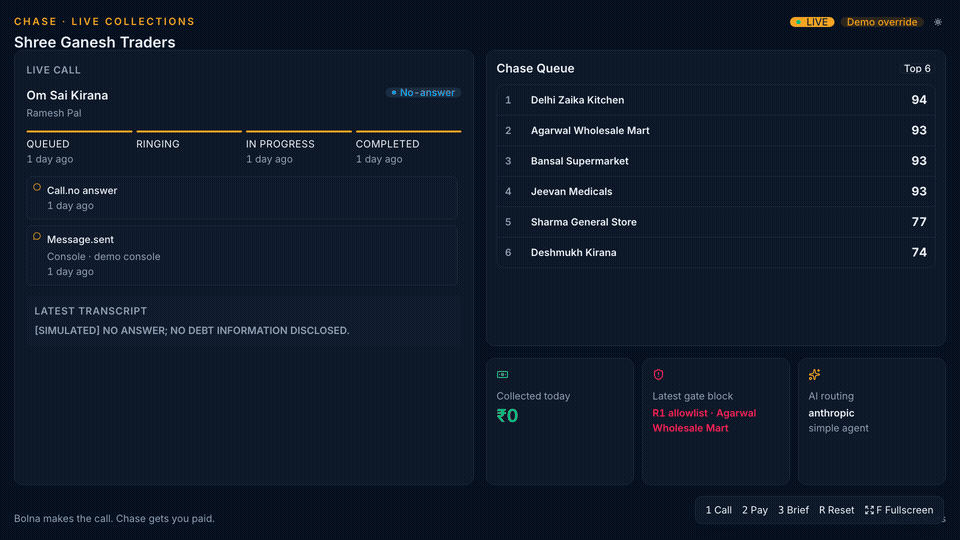
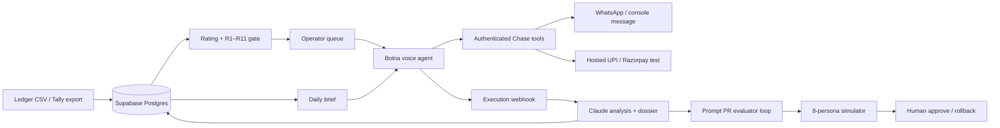

# Chase

**Bolna makes the call. Chase gets you paid.**

[](https://github.com/aadityakumarsah/chase/actions/workflows/ci.yml) Chase is the receivables and respectful collections operating layer for Indian SMBs.



**Live app:** [chase-liard.vercel.app](https://chase-liard.vercel.app) · **Source:** [github.com/aadityakumarsah/chase](https://github.com/aadityakumarsah/chase)

The public domain remains on the earlier demo deployment until exposed credentials are rotated and production Auth redirects/SMTP are confirmed. A protected Supabase-backed deployment is staged for verification.

Chase is multi-tenant: users can sign up with email, create a workspace, invite teammates and run their own receivables. Google sign-in appears only when enabled in Supabase. Identity is Supabase Auth; every workspace's data, calling policy and merchant UPI ID are its own. See [docs/multi-tenancy.md](docs/multi-tenancy.md).

## The problem

Indian distributors and wholesalers sell on credit, but the follow-up work still lives in an owner’s head, ledger and WhatsApp. A voice agent can place a call; it does not decide who to call, enforce restraint, take useful action during the conversation, reconcile what happened, or tell the owner what needs attention tomorrow.

## What Chase does

- Offers Free, monthly/yearly Pro and sales-assisted Enterprise workspaces through Dodo-hosted subscription checkout and signed webhooks; live billing is configuration-dependent.
- Ranks every account with a deterministic, explainable **Chase Rating**: probability of paying × amount × urgency ÷ effort.
- Applies auditable R1–R11 contact gates before every call, callback and campaign attempt.
- Gives Bolna seven authenticated tools for payment links, promises, status checks, callbacks, disputes, opt-outs and owner transfer.
- Turns calls into typed outcomes, an updated Contact Dossier, a fresh rating and a reordered queue.
- Calls the owner with a numbers-guarded Daily Management Brief and account-level follow-up facts.
- Proposes evidence-backed Prompt PRs, then red-teams base and candidate prompts. Shared-agent approval is currently limited to an isolated single-workspace demo.

## Architecture



One strict TypeScript Next.js application serves the dashboard, public integration routes and cron in Vercel’s Mumbai region. Postgres is the source of truth; SWR supplies live polling without a second realtime stack.

## How Chase uses Claude

- **Structured outputs with Zod** for analysis, dossiers, briefs, simulator turns, judges, supervisor flags and Prompt PRs. Invalid output cannot change account state.
- **Strict tools** in the simulator and the optional custom-LLM proxy, using the same production validators as the Bolna tools.
- **Prompt caching** on stable system prefixes, with cache reads and hit rate visible in AI Ops.
- **FAST / SMART / DEEP routing** for latency-sensitive supervision, conversational reasoning and management synthesis.
- **Live supervisor and streaming output guard** for opt-outs, AI questions, third parties, hardship, disputes and banned threats.
- **Prompt PR evaluator–optimizer loop** with verbatim evidence, protected sections, deterministic validation and base-versus-candidate simulation.
- **Eight-persona red-team simulator** covering partial payment, promises, anger, AI disclosure, third parties, disputes, hardship and evasion.
- **Numbers guard** that rejects or removes any narrative figure not grounded in deterministic brief metrics.
- **Provider-agnostic fallbacks** with explicit selection and telemetry—never a silent model switch.

## How Chase uses Bolna

- Custom function tools with independent bearer authentication and per-call tokens.
- Simple and graph-agent modes, including payment/link event injection during a live call.
- Execution webhooks plus reconciliation polling for terminal facts, audio latency, cost and recording.
- The Web Call SDK for a no-phone fallback in the Voice Lab.
- Sarvam/Kalpa-compatible Hindi and Hinglish voice configuration.
- Bolna calling guardrails plus Chase’s stricter account-level gate.
- An optional OpenAI-compatible custom-LLM proxy that streams Claude text and tool calls back to Bolna.

## Compliance by construction

Chase’s R1–R11 gate covers allowlisting, consent, permanent opt-out, dispute and wrong-number holds, calling windows, daily/weekly caps, minimum gaps, hardship gaps, active promises and in-flight calls. Identity must be confirmed before dues; the agent discloses it is AI; third parties hear no account facts; every gate decision is append-only.

The hard 08:00–19:00 IST boundary follows the RBI’s 12 August 2022 recovery-agent direction, which prohibits calls before 8 a.m. and after 7 p.m.; Chase defaults to the narrower 09:00–18:30 window. See the [RBI notification](https://www.rbi.org.in/Scripts/NotificationUser.aspx?Id=12378&Mode=0). These are product safeguards, not legal advice or a claim of regulatory certification.

## Measured demo evidence

After `pnpm demo:reset`, the committed fictional portfolio contains **69 simulated test calls**, **57 connected** (**82.6%**), **23 promise records**, **₹38,000 in clearly labelled simulated/test-mode collections**, and **620 ms p50 time to first audio**. These figures are fixture-backed demo evidence, not customer or production performance.

The Part 9 local proxy acceptance measured **1,475 ms p50 request-to-first-provider-token**, above the 900 ms target; the repository records that miss rather than relabelling it as a pass.

## Run locally

Requirements: Node 22+, Corepack, Postgres and Bolna/Claude credentials for live integrations.

```bash
corepack enable
corepack pnpm install --frozen-lockfile
corepack pnpm db:migrate
corepack pnpm demo:reset
corepack pnpm dev
```

Quality and acceptance commands:

```bash
corepack pnpm typecheck
corepack pnpm lint
corepack pnpm test
corepack pnpm build
corepack pnpm secret:scan
corepack pnpm verify:e2e
```

`verify:e2e` checks health, deployed Bolna URLs, service authentication, tenant API denial and two simulator personas. Set `E2E_BUSINESS_ID` to explicitly run a dry campaign and non-delivering brief preview for one workspace. It never places a phone call.

## Environment reference

Copy `.env.example` to `.env`; every example value is intentionally blank. Never commit the populated file.

| Area                    | Required keys                                                                 |
| ----------------------- | ----------------------------------------------------------------------------- |
| App and database        | `APP_BASE_URL`, `DATABASE_URL`, `DEMO_MODE`, `DEFAULT_TZ`                     |
| User accounts           | `NEXT_PUBLIC_SUPABASE_URL`, `NEXT_PUBLIC_SUPABASE_PUBLISHABLE_KEY`            |
| Public service auth     | `CHASE_TOOL_SECRET`, `CHASE_WEBHOOK_SECRET`, `CHASE_PROXY_KEY`, `CRON_SECRET` |
| Bolna                   | `BOLNA_API_KEY`, both agent IDs, voice/model/provider settings                |
| Claude / compatible LLM | `LLM_PROVIDER` and its provider key; optional task model overrides            |
| Demo calling            | `CALL_ALLOWLIST`, `DEMO_DEBTOR_PHONE`, `OWNER_PHONE`                          |
| Messaging               | console by default; Meta or Twilio keys for external delivery                 |
| Payments                | hosted simulator by default; merchant identity or Razorpay test keys          |

See [Dodo subscription setup](docs/billing-dodo.md), [the business workflow](docs/user-workflow.md), [setup](docs/setup.md), [LLM layer](docs/llm-layer.md) and [demo guide](docs/DEMO.md) for business onboarding, Google sign-in, imports, call controls, payment simulation, hosting and acceptance.

## Roadmap

- Direct Tally and Google Sheets import.
- NBFC partner mode with institution-specific policy packs and review controls.
- Marathi and Tamil conversation/evaluation suites.
- Kavach inbound scam-defence mode on a separate number.

## Team

**Aaditya Sah** — product, engineering and voice AI. Built for the Bolna × YC Symphony Buildathon.
